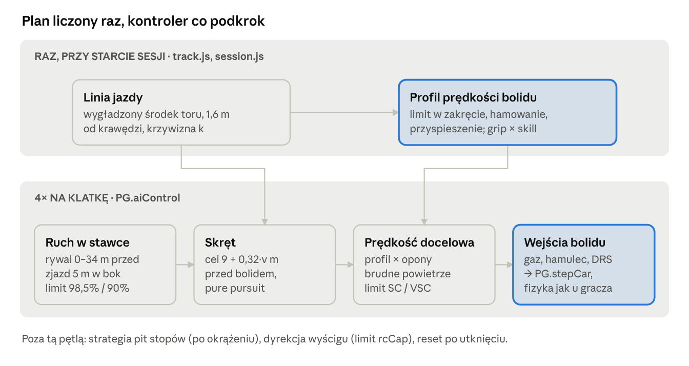

# WORLD GP — jak działa AI bolidów

## Wprowadzenie

AI bolidów w WORLD GP nie uczy się ani nie przeszukuje drzewa decyzji. Każdy bolid AI jedzie po wyliczonej raz linii jazdy z prędkością z wyliczonego raz profilu prędkości, a w każdej klatce prosty kontroler zamienia te dwie rzeczy na skręt, gaz i hamulec. Różnice między kierowcami i poziomami trudności biorą się z jednego współczynnika `skill`, który obniża przyczepność w profilu prędkości.

AI steruje bolidem tymi samymi wejściami co gracz (`steer`, `throttle`, `brake`, `drsOpen`), a ruch liczy ta sama fizyka (`PG.stepCar` → `PG.Veh.step`: model na czterech kołach z oponami Pacejki, przeniesieniem obciążenia i temperaturą opon). Nie ma teleportacji ani „gumki” (rubber banding).

Dokumentacja opisuje wersję gry 2026.10.22.2 w repozytorium [danropl/world-gp](https://github.com/danropl/world-gp).

| Plik | Rola w AI |
| --- | --- |
| `js/track.js` | linia jazdy (`racingLine`) i profil prędkości (`PG.speedProfile`) |
| `js/vehicle.js` | model bolidu, obwiednia osiągów (`PG.Veh.envelope`), regulator skrętu AI, ABS, TC i pomoc stabilności |
| `js/session.js` | poziomy trudności (`DIFF`), `setupAI`, pętla sesji, brudne powietrze, uszkodzenia |
| `js/physics.js` | kontroler `PG.aiControl`, parametry bolidów, `PG.resetCar`, kolizje |
| `js/pit.js` | strategia pit stopów (`Pit.aiPlan`, `Pit.suggest`) |
| `js/racecontrol.js` | awarie, zjazd na pobocze, SC i VSC, limity prędkości |
| `js/quali.js` | symulowane czasy AI w kwalifikacjach |
| `js/multi.js` | multiplayer: host prowadzi AI, przejęcie bolidu |



Górny pas liczy się raz, dolny co 8 ms (ok. 2 razy na klatkę) dla każdego bolidu AI; schemat pochodzi z wersji sprzed nowego modelu bolidu, ale podział jest ten sam. Cała „inteligencja” jazdy siedzi w profilu prędkości, a kontroler tylko go realizuje.

## 1. Linia jazdy

Linia jazdy to jedno przesunięcie boczne `o[i]` dla każdej próbki osi toru, liczone raz przy wczytaniu toru (`racingLine` w `track.js`). Wszystkie bolidy AI jadą po tej samej linii.

Algorytm to iteracyjne wygładzanie, a nie optymalizacja czasu okrążenia:

1. Start: `o[i] = 0`, czyli środek toru.
2. Dla każdej próbki `i` bierze punkty linii `st` próbek przed i za nią, liczy ich środek i rzutuje go na normalną toru w punkcie `i`.
3. Nowe przesunięcie to `0,3 × stare + 0,7 × rzut`, obcięte do `±(hw − 1,6)` m, gdzie `hw` to połowa szerokości toru. Bolid zostaje 1,6 m od krawędzi.
4. Kroki `st` maleją: 48, 24, 12, 6, 3, 1 próbek. Dwa pierwsze po 120 iteracji, pozostałe po 80. Duży krok prostuje całe zakręty (zewnętrzna – wewnętrzna – zewnętrzna), mały wygładza szczegóły.

Potem dla każdego punktu linii liczona jest odległość do następnego (`L.ds`) i krzywizna `L.k` z okręgu przez trzy punkty oddalone o ±7 próbek. Krzywizna to jedyna informacja o zakręcie, z której korzysta dalej profil prędkości i hamowanie AI.

Ta sama linia jest rysowana graczowi jako podpowiedź (ustawienie „Linia jazdy”), a samochód bezpieczeństwa też po niej jedzie.

## 2. Profil prędkości

Profil prędkości to tablica `profile.v[i]`: największa prędkość, z jaką dany bolid może przejechać każdy punkt linii jazdy. Liczy go `PG.speedProfile(T, p)` w `track.js`, osobno dla każdego bolidu, z jego mocy, oporu, docisku, przyczepności i setupu. Zwraca też teoretyczny czas okrążenia `lapTime`.

**Obwiednia osiągów.** Profil nie używa już stałych `latA0`, `brkA0`, `tracA0`. Zamiast nich `PG.Veh.envelope(p)` w `vehicle.js` liczy z tego samego modelu, którym jedzie bolid (opony Pacejki z czułością na nacisk, docisk zależny od prześwitu, przeniesienie obciążenia, hamulce, V10 i skrzynia, setup), pięć tablic dla prędkości 0–110 m/s co 1 m/s:

| Tablica | Co zawiera | Jak liczona |
| --- | --- | --- |
| `lat` | największe przyspieszenie boczne | bisekcja: obie osie mają zapas przy bocznym przeniesieniu obciążenia (podział według stabilizatorów z setupu), tył dodatkowo przenosi siłę przeciw oporowi; przy małej prędkości korekta zmierzona na skidpadzie R = 15–50 m |
| `brk` | największe opóźnienie z ABS | oś blokuje się na szczycie opony albo kończy się moment hamulca (balans z setupu) |
| `trac` | największe przyspieszenie z przyczepności | 98% przyczepności tylnej osi z przeniesieniem obciążenia do tyłu |
| `eng` | przyspieszenie z silnika | bieg automatu, krzywa momentu V10, masa zastępcza z bezwładnością kół i silnika |
| `drag` | opóźnienie od oporu | opór powietrza i toczenia przy docisku z tej prędkości |

Obwiednia jest liczona raz dla zestawu parametrów i trzymana w pamięci podręcznej. Wartości pośrednie daje `PG.Veh.envAt(tablica, v)`.

**Krok 1. Limit w zakręcie.** Największa prędkość, przy której `lat(v) ≥ |k|·v²` (bisekcja), gdzie k to krzywizna linii. Gdy docisk utrzyma bolid przy każdej prędkości, limitem jest 110 m/s (396 km/h).

**Krok 2. Hamowanie (przebieg wstecz).** Od końca okrążenia do początku: prędkość w punkcie `a` nie może przekroczyć prędkości, z której da się wyhamować do punktu `b` na odcinku `ds`. Opóźnienie to `brk(v) × brakeMul × lonAvail + drag(v)`.

**Krok 3. Przyspieszenie (przebieg w przód).** Od początku do końca: prędkość w kolejnym punkcie nie może przekroczyć tego, co bolid zdąży osiągnąć. Przyspieszenie to `min(trac(v) × lonAvail, eng(v)) − drag(v)`.

**Koło tarcia.** `lonAvail(k, v) = √(1 − u²)`, gdzie `u = k·v² / lat(v)` to wykorzystana część przyczepności bocznej. Bolid nie może więc jednocześnie w pełni hamować i w pełni skręcać, tak jak w fizyce.

Oba przebiegi wykonują się dwa razy po 2N próbek, żeby domknąć okrążenie. Wynik to wykres prędkości z płaskimi prostymi, rampami hamowania przed zakrętami i dołkami w zakrętach. Ten wykres jest „planem jazdy” każdego bolidu AI.

Ta sama obwiednia daje też `car.maxCurv` (największą krzywiznę przy obecnej prędkości i przyczepności opon), z której korzysta skręt AI i asysta kierownicy gracza, oraz liczby w ekranie setupu (prędkość maksymalna, przyczepność boczna, hamowanie, czas idealnego okrążenia).

## 3. Poziom trudności i umiejętność kierowcy

Poziom trudności nie zmienia zachowania AI, tylko jego profil prędkości. `setupAI` w `session.js` buduje profil z przyczepnością pomnożoną przez `skill`, więc słabszy kierowca wcześniej hamuje i wolniej przejeżdża zakręty. Na prostych wszyscy jadą tym samym bolidem: decyduje moc i opór zespołu.

```math
skill = \min\bigl(0{,}995,\ DIFF + (pace - 86)\cdot 0{,}0032 + (wet - 85)\cdot 0{,}002\bigr)
```

Składnik `wet` (umiejętność jazdy w deszczu) działa tylko na mokrym torze. `pace` i `wet` to atrybuty kierowcy z `data.js` albo z kreatora.

| Poziom | `DIFF` | Przykład: `skill` kierowcy z `pace` 80 / 86 / 95 (sucho) |
| --- | --- | --- |
| Łatwy | 0,865 | 0,846 / 0,865 / 0,894 |
| Normalny | 0,925 | 0,906 / 0,925 / 0,954 |
| Trudny | 0,972 | 0,953 / 0,972 / 0,995 (limit) |

Prędkość w zakręcie rośnie mniej więcej z pierwiastkiem przyczepności, więc `skill` 0,925 daje około 96% prędkości w wolnym zakręcie, a 0,865 około 93%.

Skąd jeszcze biorą się różnice między bolidami AI:

- **Bolid zespołu** (`PG.carParams` w `physics.js`): moc z atrybutu `power` i silnika, docisk i opór z `aero`, przyczepność z `aero` i `tyre`, zużycie opon z `tyre` zespołu i kierowcy.
- **Start**: czas reakcji `0,16 + (100 − start) × 0,006 + losowo 0–0,12` s oraz `launchBoost` (przyczepność tylnych opon × 0,9–1 przez pierwsze 3 s) z atrybutu `start`.
- **Setup**: profil liczy się z setupu bolidu. AI jeździ na domyślnym, gracz na swoim zapisanym dla toru.
- **Bolid gracza prowadzony przez AI** (tryb auto, po mecie, przejęcie w multiplayer) dostaje `skill` co najmniej 0,95.

**Kwalifikacje.** AI nie jedzie okrążeń kwalifikacyjnych. `PG.simQualiTime` liczy profil na nowych miękkich oponach (na mokrym: deszczowe) i zwraca `lapTime × 1,032 + losowo 0–0,35 s`. Mnożnik 1,032 to zmierzona różnica między idealnym profilem a okrążeniem AI na pełnej fizyce (temperatura opon, regulator, korekty z rozdziału 4). `quali.js` dodaje lekkie przyspieszanie toru w kolejnych segmentach.

## 4. Kontroler AI krok po kroku

`PG.aiControl(car, T, cars, env, dt)` w `physics.js` ustawia skręt, gaz, hamulec i DRS. Pętla sesji liczy fizykę co 2 ms, a decyzje AI co 8 ms (przy 60 kl./s to ok. 2 razy na klatkę). Między decyzjami skręt i tak jest regulowany w każdym kroku fizyki przez `vehicle.js` (rozdział 4.2).

### 4.1 Skręt: krzywizna z linii jazdy

`car.steer` u AI nie jest kątem kierownicy, tylko żądaną krzywizną toru jazdy jako ułamkiem `maxCurv`. Krzywiznę liczą dwie metody:

1. **Pure pursuit** (daleko od linii, np. po wyjeździe z toru). Punkt celu leży na linii jazdy `look = 12 + 0,36 × v` m przed bolidem (v w m/s), z przesunięciem bocznym `car.offset` (rozdział 5), obciętym tak, by cel był co najmniej 2,2 m od krawędzi. Krzywizna łuku przez cel: `curv = 2 × sin(ang) / max(dist, 4)`, gdzie `ang` to kąt między kierunkiem ruchu bolidu (kurs + kąt znoszenia) a kierunkiem do celu.
2. **Śledzenie linii** (blisko linii: odchyłka boczna `ey` < 3 m, odchyłka kursu `eh` < 0,35 rad, v > 6 m/s). Krzywizna linii z wyprzedzeniem plus korekta odchyłek:

```math
curv = k_{ff} + \frac{e_y}{L_p^2} + \frac{1{,}6 \cdot \sin(e_h)}{L_p}, \qquad L_p = 7 + 0{,}22 \cdot v
```

`k_ff` to średnia krzywizna linii z trzech próbek `1 + 0,06 × v` m przed bolidem. Przy granicach (`ey` 1,5–3 m, `eh` 0,2–0,35 rad) obie metody są płynnie mieszane. Czyste pure pursuit ścinało zmiany krzywizny i spóźniało obrót na wyjściach z zakrętów.

3. `steer = curv / maxCurv`, obcięte do ±1.

### 4.2 Skręt w fizyce: regulator prędkości odchylania

W `vehicle.js`, w każdym kroku 2 ms, żądana krzywizna `kc = steer × maxCurv` zamienia się na kąt kół:

```math
\delta = k_c \cdot L + I + 2{,}2 \cdot L \cdot (k_c - r / v), \qquad \dot I = 8 \cdot L \cdot (k_c - r / v), \quad |I| \le 0{,}12
```

gdzie L to rozstaw osi, a r prędkość odchylania. Do tego:

- **Kontra przy nadsterowności:** gdy kąt znoszenia tylnej osi przekracza szczyt opony, kąt kół rośnie o `1,2 × nadmiar` w stronę kontry. Sama prędkość odchylania tego nie widzi, bo bolid w poślizgu „płynie” bokiem, a r rośnie powoli.
- **Limit podsterowności:** kąt kół jest ograniczony do kierunku ruchu przedniej osi ± 1,05 × kąt szczytu przedniej opony. Skręcanie dalej niż szczyt nic nie daje, tylko grzeje i zużywa opony.

### 4.3 Gaz i hamulec: trzymanie prędkości z profilu

1. Prędkość docelowa to wartość profilu w punkcie `2 + 0,05 × v` m przed bolidem, razy `ai.pace` (domyślnie 1).
2. **Korekta za opony i pogodę:** `gr = przyczepność opon teraz / przy budowie profilu × min(1, gripT)`, gdzie `gripT` to współczynnik temperatury opon słabszej osi. W zakrętach, strefach hamowania i gdy `gr > 1` cel mnoży się przez √gr. Zimne, przegrzane albo zużyte opony = wolniej w zakrętach.
3. Korekta za brudne powietrze (rozdział 5.3).
4. **Wcześniejsze hamowanie.** Profil zakłada pełne hamowanie w czystym powietrzu na dobrych oponach. Gdy skuteczność `fB` jest mniejsza, AI hamuje wcześniej: `v² = vmin² + fB × (vp² − vmin²)`, gdzie `vmin` to najmniejsza prędkość profilu na drodze hamowania (`v² / 24` m, najwyżej 260 próbek). `fB` to iloczyn: `min(1, gr)`, utraty docisku w brudnym powietrzu, 0,93 w ciasnej stawce (rywal bliżej niż 40 m) i do 0,8 przy jeździe poza linią po zewnętrznej (trzeba jeszcze skręcać na hamowaniu; po wewnętrznej tej kary nie ma, bo ciaśniejszy łuk obniża cel w punkcie 5).
5. **Poza linią po wewnętrznej** (wyprzedzanie, unikanie) promień jest mniejszy niż w profilu: cel × √(max(0,5, 1 − k × Δ)), gdzie Δ to odległość od linii.
6. **Poza asfaltem** (`|lat| > hw + 0,5`) bolid łagodnie zwalnia: cel nie niżej niż 30 m/s i najwyżej 0,5 m/s poniżej obecnej prędkości, hamulec najwyżej 0,35. Gwałtowne hamowanie na krawężniku w zakręcie kończyło się obrotem.
7. Limity z ruchu w stawce (`cap`, rozdział 5) i samochodu bezpieczeństwa (`rcCap`, rozdział 9).
8. Regulator z martwą strefą:

| Sytuacja | Gaz | Hamulec |
| --- | --- | --- |
| v < cel − 0,2 m/s | `min(1, (cel − v) / 1,5 + 0,5)` | 0 |
| v > cel + 0,4 m/s | 0 | `min(1, (v − cel) / 1,5)`, poza torem najwyżej 0,35 |
| pomiędzy | 0,4 | 0 |

Pełny hamulec i pełny gaz nie wywracają bolidu, bo AI zawsze ma ABS, kontrolę trakcji i pomoc stabilności w kole tarcia (rozdział 6). Bo profil ma już wbudowane hamowanie (rozdział 2), AI nie musi przewidywać zakrętów: wystarczy, że trzyma się prędkości z profilu kilka metrów przed sobą.

### 4.4 DRS

AI otwiera DRS, gdy ma do niego prawo (`drsAllowed`: od drugiego okrążenia, na suchym torze, strata do bolidu przed nim poniżej 1,0 s w punkcie detekcji; uprawnienie trwa do końca najbliższej strefy; ta sama zasada co dla gracza), jest w strefie DRS, `steer` jest w granicach ±0,3 i nie hamuje. Każde z tych zdarzeń zamyka klapę przy następnej decyzji.

## 5. Ruch w stawce: wyprzedzanie, jazda za rywalem, aerodynamika

AI wyprzedza, zjeżdżając z linii jazdy o 5 m w bok od rywala, a gdy nie ma miejsca, zwalnia do jego prędkości. Nie broni pozycji: nie ma logiki blokowania ani zmiany linii pod atakującego (pole `ai.attack` istnieje, ale nic go nie używa).

### 5.1 Decyzja o wyprzedzaniu

Na początku każdego wywołania `aiControl` przegląda wszystkie bolidy (poza wycofanymi i „duchami” po resecie). Rywal jest „na drodze”, gdy jest 0–34 m przed nim po osi toru i różnica pozycji bocznej jest mniejsza niż 4,4 m, liczona do obecnej pozycji AI albo do toru, na który AI zaraz wróci (przesunięcie ograniczone przed zakrętem, patrz niżej). W trakcie wyprzedzania (strona już wybrana) próg rośnie do 5,6 m, żeby AI nie wracało na linię, gdy jest już obok rywala. Wtedy:

1. AI sprawdza, czy jest szybsze: obecna prędkość większa od rywala o 0,3 m/s albo prędkość z profilu w tym miejscu większa o 1,5 m/s.
2. Wybiera stronę: wewnętrzną najbliższego zakrętu w zasięgu 500 m (tam można później hamować), jeśli przy rywalu jest po niej co najmniej 4,5 m do krawędzi; inaczej stronę, po której jest więcej miejsca (`roomR = hw − o.lat`, `roomL = o.lat + hw`). Zapamiętuje ją w `ai.side`, żeby nie przeskakiwać z boku na bok.
3. Docelowe przesunięcie = pozycja rywala ± 5,0 m, liczone względem linii jazdy, najwyżej do 2,2 m od krawędzi.

**Przed zakrętem i w zakręcie AI trzyma się linii po zewnętrznej.** Szerszy tor jazdy przy prędkości z profilu wynosi bolid z toru, więc przesunięcie na zewnętrzną jest ograniczone według największej krzywizny na odcinku `20 + 1,2 × v` m przed bolidem. Po wewnętrznej wolno do 5,5 m (atak na hamowaniu), ale nie na 1. okrążeniu: w ciasnej stawce przed pierwszym zakrętem kończyło się to kontaktem.

| Krzywizna przed bolidem | Najwyższe przesunięcie na zewnętrzną | Tempo zmiany przesunięcia |
| --- | --- | --- |
| promień < 250 m | 1,5 m | 3 / s |
| promień 250–600 m | 3 m | 3 / s |
| prosta lub łagodny łuk | bez limitu | 1,6 / s |

Przesunięcie zmienia się płynnie: `offset += (cel − offset) × min(1, tempo × dt)`. Gdy nikogo nie ma na drodze, `ai.side` się zeruje, a cel wraca do 0, czyli na linię jazdy.

**Przeszkoda.** Bolid wolniejszy niż 60% prędkości AI i niż 20 m/s (obrót, uszkodzenie) w zasięgu drogi hamowania (`12 + v² / 40` m) AI objeżdża od razu, także przed zakrętem i w zakręcie (limit przesunięcia nie obowiązuje, tempo 3 / s). Hamuje przed nim tylko wtedy, gdy przeszkoda zajmuje jego tor: w odległości bocznej `2,4 + 2,5 × |sin(kąt obrotu)|` m (bolid obrócony w poprzek zajmuje więcej szerokości).

**Bolid obok.** Gdy rywal zachodzi na AI (±5,5 m wzdłuż toru, bolid ma 5 m długości; mniej niż 4 m w bok; jedzie szybciej niż 3 m/s), AI nie zjedzie na niego bokiem: cel przesunięcia jest obcięty tak, by zostało co najmniej 2,5 m odstępu do jego pozycji. Gdy rywale są po obu stronach, AI jedzie środkiem między nimi. Jeśli bolid obok jest z przodu o ponad 1,5 m, AI odpuszcza i chowa się za nim (prędkość docelowa najwyżej `o.v − 1,5` m/s). Bolid tuż za AI w tym samym torze (ponad 3 m z tyłu, mniej niż 1,5 m w bok) nie przesuwa AI: unikać ma jadący z tyłu. Ta zasada ograniczyła kontakty na pierwszym okrążeniu, zwłaszcza w szykanach.

### 5.2 Jazda za rywalem

- **Odstęp:** gdy rywal jest bliżej niż 11 m i różnica boczna jest mniejsza niż 3,4 m (AI nie zdążyło jeszcze zjechać obok), prędkość docelowa jest ograniczona do 98,5% prędkości rywala, a poniżej 7 m do 90%. Przy objeżdżaniu bardzo wolnego bolidu (poniżej 8 m/s) AI nie zwalnia poniżej 6 m/s.
- **Rywal hamuje:** gdy hamuje (hamulec > 0,2) i jest wolniejszy, w zasięgu 34 m i 3 m w bok, AI zostawia sobie drogę hamowania: `cel ≤ √(o.v² + 2 × 18 × max(0, d − 8))`.
- **Bardzo wolny bolid przed nami** (przeszkoda z rozdziału 5.1, gdy zajmuje tor AI): to samo z opóźnieniem 20 m/s² i zasięgiem `12 + v² / 40` m, czyli całą drogą hamowania.
- **Ciasna stawka:** rywal bliżej niż 40 m i 3 m w bok → AI hamuje do zakrętów odrobinę wcześniej (`fB × 0,93`, rozdział 4.3).

Kolizje i tak są liczone przez `PG.collide`, a uszkodzenia z kontaktu dwóch bolidów AI są mnożone przez 0,6 („AI między sobą ostrożniejsze”).

### 5.3 Brudne powietrze i tunel aerodynamiczny

Funkcja `slipstream` w `session.js` liczy dla każdego bolidu dwie wartości z bolidów przed nim:

| Efekt | Zasięg | Siła | Skutek |
| --- | --- | --- | --- |
| Tunel (`slip`) | 4–36 m przed, ±3,2 m w bok | opór × (1 − 0,3 × (1 − d/36)), do −30% tuż za rywalem | szybciej na prostych |
| Brudne powietrze (`dirty`) | 3–35 m przed, ±3,5 m w bok | waga 0–1; docisk przodu × (1 − 0,26 × dirty), tyłu × (1 − 0,14 × dirty) | wolniej w zakrętach, podsterowność |

Fizyka działa tak samo na gracza i AI. Przód traci więcej docisku niż tył, więc za rywalem bolid wyraźnie podsterowuje. AI dodatkowo obniża prędkość docelową w zakręcie, gdy wykorzystuje ponad 30% przyczepności i jedzie w brudnym powietrzu, oraz hamuje wcześniej (rozdział 4.3). Bez tej korekty AI wjeżdżałoby w zakręt za szybko, bo profil liczono w czystym powietrzu. Efekt: tak jak w F1, AI łatwo dogania rywala na prostej, ale trudno mu jechać tuż za nim w zakrętach.

## 6. Pomoce AI w fizyce

AI jedzie tą samą fizyką co gracz: cztery koła z oponami Pacejki, przeniesienie obciążenia, zawieszenie, temperatura i zużycie opon, uszkodzenia. Nie ma już dodatkowej przyczepności odciążonej osi (dawne `kF`, `kR`), hamowania liczonego z krzywizny linii (`ulB`) ani udawanych blokad kół (`aiLockT`). AI może więc naprawdę stracić bolid, a chronią je te same pomoce, które gracz może włączyć w ustawieniach, w najmocniejszej wersji.

| Mechanizm | Gracz | AI | Gdzie |
| --- | --- | --- | --- |
| ABS | według ustawień: limit momentu z modelu opony przy poślizgu ok. 0,9 szczytu i modulator ciśnienia na każde koło | zawsze: siła hamowania z koła tarcia (0,97 przyczepności, której nie zużywa siła boczna przy obecnym kącie znoszenia), ten sam modulator | `vehicle.js`, `absOn` |
| Kontrola trakcji | poziom 0–3 (1–2: limit łącznego poślizgu, 3: koło tarcia) | zawsze jak poziom 3, z zapasem momentu na rozpędzenie kół i silnika | `vehicle.js`, `tcOn`, `tcLvl` |
| Pomoc stabilności | według ustawień | zawsze: mniej gazu, gdy bolid obraca się szybciej, niż wynika z toru jazdy, albo kąt znoszenia tyłu przekracza 1,25 szczytu opony | `vehicle.js`, `stabOn` |
| Skręt | kierownica wprost albo pad z asystą (pełne wychylenie = szczyt przedniej opony + 20%), opcjonalnie pomoc kontry | regulator prędkości odchylania z kontrą od kąta tyłu i limitem na szczycie przedniej opony (rozdział 4.2) | `vehicle.js` |
| Skrzynia biegów | automatyczna albo ręczna, według ustawień | zawsze automatyczna | `session.js`, `manual` |
| Setup | własny, zapisany dla toru | domyślny | `session.js`, `setup` |

Koło tarcia w ABS i TC to odpowiednik idealnie dozowanego hamulca i gazu: profil prędkości zakłada, że hamowanie i przyspieszenie dzielą przyczepność ze skrętem, i fizyka daje AI dokładnie tę część, której nie zużywa siła boczna.

**Start.** Przed zgaszeniem świateł AI stoi na hamulcu. Po starcie czeka swój czas reakcji (rozdział 3), potem przejmuje kontroler. Przez pierwsze 3 s przyczepność tylnych opon mnoży `launchBoost` z atrybutu `start`. Falstart może popełnić tylko gracz.

## 7. Odporność: utknięcie, wyjazd z toru, uszkodzenia

Gdy coś pójdzie nie tak, AI ma trzy zabezpieczenia: limit prędkości poza torem, reset po utknięciu i wolniejszy profil po uszkodzeniu.

- **Poza torem.** Gdy bolid jest dalej niż 0,5 m za krawędzią, łagodnie zwalnia do najwyżej 30 m/s (108 km/h) z hamulcem do 0,35 (rozdział 4.3). Kontroler skrętu i tak celuje w linię jazdy, więc bolid wraca na tor.
- **Poślizg.** Kontra od kąta tyłu w regulatorze skrętu i pomoc stabilności łapią większość poślizgów (rozdział 4.2 i 6). Gdy bolid mimo to się obróci, AI za nim hamuje na czas (rozdział 5.2).
- **Utknięcie.** Od 6. sekundy wyścigu bolid AI jadący wolniej niż 3 m/s przez ponad 3 s jest resetowany (`PG.resetCar`): 10 m wstecz na linię jazdy, prosto, 8 m/s, bez przesunięcia bocznego. Przez 2,5 s jest „duchem” (`ghost`), żeby nie zderzył się z nadjeżdżającymi. Reset nie naprawia uszkodzeń.
- **Uszkodzenia.** Po każdym uszkodzeniu `flushDamage` w `session.js` sprawdza, czy zmienił się wpływ na osiągi (moc, opór, docisk, przyczepność z `PG.dmgPerf`). Jeśli tak, najwyżej co 0,5 s przebudowuje profil prędkości (`rebuildProfile`). Bolid z urwanym skrzydłem zaczyna więc hamować wcześniej i wolniej jechać zakręty, zamiast wypadać z toru.
- **Decyzja po uszkodzeniu.** W trybie pełnych uszkodzeń bolid AI odpada z wyścigu, gdy suma uszkodzeń przekracza 0,6, silnik jest zniszczony albo oba przednie zawieszenia są zniszczone. Lżej uszkodzony bolid przechodzi przez strategię pit stopów (rozdział 8), która może wezwać go po nowe skrzydło.

## 8. Strategia pit stopów

AI zjeżdża do boksu z jednego z czterech powodów, sprawdzanych w tej kolejności przez `Pit.aiPlan` w `pit.js`. Plan jest liczony po każdym okrążeniu, po każdym uszkodzeniu i przy wyjeździe samochodu bezpieczeństwa. Nie działa, gdy zostało mniej niż jedno pełne okrążenie.

| Powód | Warunek |
| --- | --- |
| Uszkodzenie (`dmg`) | przednie skrzydło uszkodzone ponad 0,38 albo tylne ponad 0,5 |
| Zużycie opon (`wear`) | zużycie ≥ próg bolidu i przy obecnym tempie zużycia opony doszłyby do mety ponad 0,9 |
| Zasada dwóch mieszanek (`rule`) | na suchym torze, od 10 okrążeń, bolid użył jednej mieszanki i zostało nie więcej niż 35% dystansu (co najmniej 2 okrążenia) |
| Tani postój pod SC/VSC (`sc`) | zostało ponad 4 okrążenia i zużycie > 0,32 albo zasada dwóch mieszanek niespełniona |

Próg zużycia jest losowany raz na bolid z zakresu 0,66–0,76, dlatego bolidy AI nie zjeżdżają w tym samym okrążeniu. Twarde opony podnoszą go o 0,06, miękkie obniżają o 0,04.

**Wybór opon** (`Pit.suggest`): na mokrym torze zawsze deszczowe. Na suchym AI bierze najbardziej miękką mieszankę, która dojedzie do mety ze zużyciem najwyżej 0,82. Tempo zużycia AI mierzy na ostatnim okrążeniu (przed pierwszym pomiarem używa modelu). Jeśli zasada dwóch mieszanek nie jest spełniona i wybór wypada na obecną mieszankę, AI bierze inną.

Przejazd aleją serwisową i postój prowadzi `pit.js` tak samo jak u gracza: 80 km/h przy garażach, wymiana opon i naprawa skrzydeł.

## 9. Dyrekcja wyścigu: awarie, SC i VSC

Dyrekcja wyścigu (`racecontrol.js`) losuje awarie bolidów AI i zamienia je, razem z wypadkami, w samochód bezpieczeństwa albo VSC. Na bolidy AI działa to wyłącznie przez limit prędkości `rcCap`, który kontroler bierze pod uwagę jak każdy inny limit.

**Awarie.** Od 30. sekundy wyścigu do dwóch okrążeń przed metą każdy bolid AI poza boksem może co podkrok dostać awarię z prawdopodobieństwem `częstość × dt`. Gracz nigdy.

| Ustawienie | Częstość na bolid | Średnio jedna awaria na bolid co |
| --- | --- | --- |
| Wyłączone | 0 | nigdy |
| Rzadko | 1/45 000 na s | 12,5 h jazdy |
| Często | 1/15 000 na s | 4,2 h jazdy |

Przy N bolidach AI awaria w stawce zdarza się średnio co 45 000 / N s (rzadko) albo 15 000 / N s (często). Na przykład dla 19 bolidów AI to ok. 40 i 13 minut.

**Zjazd z toru.** Bolid z awarią albo rozbity (`RC.retire`) przestaje używać zwykłego kontrolera. `RC.retireControl` celuje w punkt 3,2 m za krawędzią toru po tej stronie, po której jest, odcina gaz i lekko hamuje. Staje, gdy jest za krawędzią albo po 20 s.

**Kiedy SC, kiedy VSC.** Bolid stojący na torze lub tuż przy nim albo rozbity: 75% szans na SC, 25% na VSC. Bolid daleko na poboczu: VSC. Odłamki (urwane skrzydło): 40% szans na VSC. Na ostatnim okrążeniu lidera zawsze VSC.

**Limity prędkości dla AI** (`RC.caps`):

- **VSC:** 58% prędkości z własnego profilu, najmniej 16 m/s.
- **SC:** kolejka bez wyprzedzania. Każdy bolid dogania bolid albo samochód bezpieczeństwa przed sobą (82% profilu), a w zasięgu 400 m dopasowuje się do jego prędkości, utrzymując odstęp 16 m za bolidem i 30 m za SC. Samochód bezpieczeństwa jedzie po linii jazdy z 60% prędkości profilu, najwyżej 50 m/s.
- **SC zjeżdża:** lider sam dyktuje tempo (60% profilu) do linii mety, gdzie następuje restart.

Wyjazd SC lub VSC wywołuje też strategię pit stopów u wszystkich bolidów AI w trybie „taniego postoju” (rozdział 8).

## 10. AI w multiplayerze

W multiplayerze wszystkie bolidy AI prowadzi host, a pozostali gracze dostają ich pozycje przez sieć. Każdy gracz liczy fizykę tylko swojego bolidu.

- **Ustawienia lobby:** „Bolidy AI” (pełna stawka albo tylko gracze) i „Poziom AI” (łatwy, normalny, trudny = `DIFF` z rozdziału 3).
- **Host:** uruchamia `aiControl` i dyrekcję wyścigu. U klienta `S.netClient` wyłącza awarie i SC, a bolidy z sieci (`remote`) są pomijane w pętli i tylko interpolowane w czasie.
- **Kwalifikacje:** gracze jadą swoje okrążenia, czasy AI host symuluje (`Q.simulate`) i rozsyła cel do awansu.
- **Rozłączenie gracza:** jego bolid przejmuje AI (`takeOver` w `multi.js`). Bolid przestaje być zdalny, czas okrążenia liczy się od chwili przejęcia, a niepełne okrążenie nie trafia do rekordów.
- **Host nie może przełączać karty:** przeglądarka wstrzymuje wtedy pętlę gry, więc zatrzymują się też wszystkie bolidy AI.

## 11. Parametry do strojenia

Największy wpływ na siłę AI ma `DIFF` w `session.js`. Pozostałe stałe zmieniają charakter jazdy, a nie tempo, więc warto je ruszać pojedynczo i sprawdzać w wyścigu, najlepiej narzędziem `tools/physics-bench.js` (wyścig bez przeglądarki, liczy DNF, resety, czas poza torem i czasy okrążeń).

| Parametr | Plik | Wartość | Co zmienia |
| --- | --- | --- | --- |
| `DIFF` (easy / normal / hard) | `session.js` | 0,865 / 0,925 / 0,972 | tempo AI w zakrętach i na hamowaniu |
| wpływ `pace` na `skill` | `session.js` | 0,0032 na punkt | rozrzut tempa między kierowcami |
| limit `skill` | `session.js` | 0,995 | najszybszy możliwy kierowca AI |
| `brakeMul` w profilu AI | `session.js` | 0,97 | zapas na hamowaniu (mniej = ostrożniej) |
| mnożnik czasu kwalifikacji | `session.js`, `simQualiTime` | 1,032 | symulowane czasy AI względem idealnego profilu |
| odległość celu skrętu | `physics.js` | 12 + 0,36 × v m | płynność skrętu daleko od linii |
| śledzenie linii, `Lp` | `physics.js` | 7 + 0,22 × v m | jak mocno AI wraca na linię (mniej = ciaśniej, ale nerwowo) |
| regulator odchylania | `vehicle.js` | wzmocnienie 2,2, całka 8, limit ±0,12 rad | jak dokładnie bolid realizuje krzywiznę |
| kontra przy nadsterowności | `vehicle.js` | 1,2 × nadmiar kąta tyłu | jak szybko AI łapie poślizg tyłu |
| podgląd prędkości | `physics.js` | 2 + 0,05 × v m | jak wcześnie AI reaguje na hamowanie z profilu |
| ciasna stawka | `physics.js` | `fB` × 0,93 do 40 m | zapas na hamowaniu w grupie |
| strefa wykrycia rywala | `physics.js` | 34 m, ±4,4 m | jak wcześnie AI zaczyna wyprzedzanie |
| odstęp boczny przy wyprzedzaniu | `physics.js` | 5,0 m | jak szeroko AI omija rywala |
| przesunięcie przy zakręcie | `physics.js` | zewnętrzna 1,5 m (R < 250 m), 3 m (R < 600 m); wewnętrzna 5,5 m od 2. okrążenia | ile AI zjeżdża z linii przed zakrętem, ataki na hamowaniu |
| tempo zjazdu w bok | `physics.js` | 3 / s przy zakręcie, 1,6 / s na prostej | jak gwałtownie AI zmienia linię |
| bolid obok | `physics.js` | ±5,5 m, odstęp 2,5 m | kontakty bokiem, zwłaszcza na 1. okrążeniu |
| limit za rywalem | `physics.js` | 98,5% (< 11 m), 90% (< 7 m) | ryzyko najechania na tył |
| utrata docisku w brudnym powietrzu | `physics.js`, `PHYS.dirtyF`, `dirtyR` | 0,26 / 0,14 | trudność jazdy tuż za rywalem (gracz i AI) |
| odstęp linii od krawędzi | `track.js` | 1,6 m | jak blisko krawędzi jeździ AI |
| próg zużycia opon | `pit.js` | 0,66–0,76 | kiedy AI zjeżdża do boksu |
| częstość awarii | `racecontrol.js` | 1/45 000, 1/15 000 na s | jak często są SC i VSC |

Znane ograniczenia, które warto rozważyć przy rozwoju:

- AI nie broni pozycji ani nie wybiera momentu ataku (`ai.attack` jest nieużywane).
- Wszystkie bolidy AI jadą po jednej linii jazdy i na domyślnym setupie.
- AI może wpaść w poślizg i wyjechać z toru, ale nie popełnia celowych błędów (np. spóźnionego hamowania pod presją).
- Mnożnik czasu kwalifikacji 1,032 zmierzono na Monzy; na torach z inną proporcją zakrętów do prostych symulowane czasy mogą się różnić o kilka dziesiątych.
- Pętla wyprzedzania przegląda wszystkie bolidy, więc koszt rośnie z kwadratem liczby bolidów (przy obecnej stawce to bez znaczenia).
